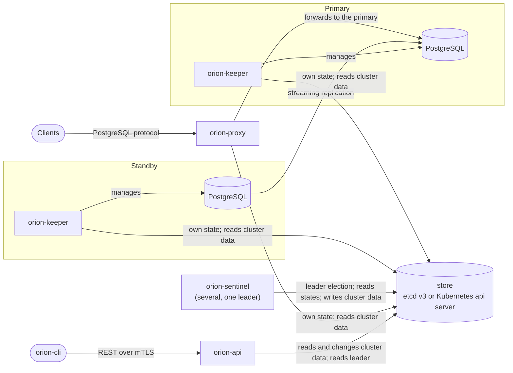

# Architecture

An Orion cluster is a set of PostgreSQL instances, each managed by a keeper, plus sentinels, proxies and the api. The
components don't talk to each other directly: they all read and write the store (etcd v3 or the Kubernetes api
server). Only the proxy and PostgreSQL itself handle client and replication traffic.

- Every keeper publishes the state of its instance in the store, and reads the cluster data to know what its
  instance must be: the primary, or a standby of which instance.
- The sentinels elect a leader in the store. The leader reads the states of the keepers and proxies, and writes the
  cluster data: which instance is the primary, and where the proxies send clients.
- A standby connects to the primary itself, with the address the primary's keeper published.
- The proxy reads the address of the primary from the cluster data, and forwards client connections to it. It
  publishes its own state, so the sentinel knows it is there.
- The api only talks to the store. It doesn't connect to keepers, sentinels or PostgreSQL.

## Components

See the [component table](index.md#components) on the home page. More about each:

- keeper: [Initialization](cluster/initialization.md), [PostgreSQL parameters](operations/postgres-parameters.md),
  [Custom pg_hba entries](operations/pg-hba.md).
- sentinel: [Sentinel decisions](operations/sentinel-decisions.md),
  [Failover and switchover](operations/failover-switchover.md).
- proxy: [Proxies after a new primary](operations/sentinel-decisions.md#proxies-after-a-new-primary).
- api and cli: [Certificates](api/certificates.md), [Bootstrap design](api/bootstrap-design.md),
  [Cluster spec](cluster/spec.md).

## Requirements

### Keepers

Every keeper needs a unique uid. Set it with `--uid` (lower-case letters, numbers and `_` only), or leave it empty and
the keeper generates one. At its first start, the keeper saves the uid in the file `keeperstate` in its data
directory. After that, it always uses the saved uid. If you start it with a `--uid` that differs from the saved one, it
refuses to start.

Every keeper needs a persistent data directory (`--data-dir`, required): not an ephemeral volume like a Kubernetes
`emptyDir`. The data directory holds the uid, the local state and the PostgreSQL data (in `postgres/`). If you lose it:

- A keeper without `--uid` comes back with a new uid: to the cluster it is a new keeper.
- Its database is gone, so it must resync from the primary.
- If all keepers lose their data directories at the same time, the cluster has no data left.

The keeper locks its data directory, so two keepers can't run on the same one. `--disable-data-dir-locking` turns that
off; don't.

### Sentinels and proxies

Sentinels and proxies have no data directory and no `--uid`. They generate a new uid at every start, and keep all their
state in the store.

### The store

| Option | Default | |
|--------|---------|---|
| `--store-backend` | (required) | `etcdv3` or `kubernetes` |
| `--store-endpoints` | `http://127.0.0.1:2379` | The etcd endpoints, comma-separated (etcdv3 only) |
| `--store-prefix` | `orion/cluster` | The prefix of the keys in etcd (etcdv3 only) |
| `--store-timeout` | `5s` | The timeout of a request to the store |

Every component (keeper, sentinel, proxy and api) needs the same `--cluster-name`, `--store-backend` and store
options.

Make the store highly available: with etcd, run at least three nodes. With etcd, a leading `/` in `--store-prefix` is
removed, so `/orion/cluster` and `orion/cluster` are the same prefix. The cluster lives under
`<store-prefix>/<cluster-name>`.

#### When a component can't reach the store

A component that can't read from or write to the store logs the error and tries again at its next check:

| Component | What it does |
|-----------|--------------|
| keeper | Leaves its PostgreSQL instance as it is, and tries again after its sleep interval (`5s` by default). |
| sentinel | Makes no decisions. When the leader election fails, it tries again after 10 seconds. |
| api | Answers `503 Service Unavailable` with `Retry-After: 2`. |
| proxy | Closes all client connections after `proxyTimeout`, see below. |

The proxy can't know whether the primary it forwards to is still the primary when it can't read the store: the
sentinel may have elected a new one. So the proxy fences itself:

- Every `proxyCheckInterval` (`5s` by default) it reads the cluster data, and publishes its own state. A check that
  takes longer than `proxyTimeout` (`15s` by default) is canceled.
- When no check succeeded for `proxyTimeout`, the proxy closes all client connections, and closes new ones right
  away.
- With `--stop-listening` (the default), it also stops listening on its port, so a load balancer sees it as down.
- As soon as a check reads the cluster data again, it listens again. It forwards to the primary once the check
  succeeds.

`proxyCheckInterval` and `proxyTimeout` are fields of the [cluster spec](cluster/spec.md).

#### etcd compaction

Orion doesn't compact etcd. Without compaction, the etcd keyspace keeps growing until etcd runs out of space. Enable
auto-compaction in etcd (`--auto-compaction-retention`, see the
[etcd maintenance guide](https://etcd.io/docs/latest/op-guide/maintenance/)).

#### The kubernetes backend

With `--store-backend kubernetes`, Kubernetes itself is the store: a ConfigMap, pod annotations and a Lease. See
[How the kubernetes backend works](deploy/k8s.md#how-the-kubernetes-backend-works). The api server is then shared with
everything else in the Kubernetes cluster: when it is overloaded or down (for example during an upgrade), the proxies
close their connections after `proxyTimeout`, as above. A dedicated etcd cluster avoids that.

#### Permanent loss of the store

If you lost the store for good, don't restore the store from a backup: the cluster data in it can be older than the
real state, and could make an old primary the primary again. Set up a new, empty store, and initialize the cluster
with init mode `existing` on the keeper with the most recent data. See
[existing](cluster/initialization.md#existing).

### PostgreSQL users

Orion needs two PostgreSQL users:

| User | Used for | Name | Password |
|------|----------|------|----------|
| superuser | The keeper's own connections to its instance, and `pg_rewind` | `--pg-su-username` (default: the user that runs the keeper) | `--pg-su-password` or `--pg-su-passwordfile` |
| replication user | Replication between the instances | `--pg-repl-username` (required) | `--pg-repl-password` or `--pg-repl-passwordfile` |

The users and passwords are options of the keepers, not part of the cluster spec: anyone who can read the store can
read the spec. Give all keepers the same values, or replication and `pg_rewind` between them fail.

When a keeper initializes a new database (init mode `new`), it creates the superuser (with initdb), sets its password,
and creates the replication user. If the superuser and the replication user have the same name, the keeper gives the
superuser the replication role instead; they must then have the same password and auth method.

The default auth method is `scram-sha-256` (`--pg-su-auth-method`, `--pg-repl-auth-method`). With `trust` no password
is used; the keeper warns, and you must not set a password. See [Custom pg_hba entries](operations/pg-hba.md) for the
`pg_hba.conf` entries the keeper writes for these users.

### max_connections

The keeper connects to its instance as the superuser. When clients use up `max_connections`, only superusers can still
connect, up to `superuser_reserved_connections`. Clients that connect as the superuser can use up those reserved
connections too, and then the keeper can't query its instance, and reports it as unhealthy. So don't let clients
connect as the superuser, or raise `max_connections`.
