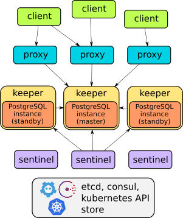

# Orion

Orion is a cluster manager for PostgreSQL. It runs PostgreSQL clusters with a primary and one or more standbys, fails
over automatically when the primary fails, and makes sure clients only connect to the current primary. You can run
Orion on virtual machines and on Kubernetes.

Orion is a fork of [stolon](https://github.com/sorintlab/stolon). It keeps stolon's keeper, sentinel and proxy, and adds
a REST api with a cli on top of it, secured with TLS and client certificates.

## TL;DR

- Every PostgreSQL instance is managed by a **keeper**. The leader **sentinel** decides which keeper runs the primary,
  and clients connect through a **proxy**, which only sends connections to the current primary.
- The cluster state lives in a highly available store: etcd (v2 or v3 api), consul or the Kubernetes api server.
- You manage clusters with the **api** and the **cli** (`orion`).
- Orion prefers consistency over availability: when in doubt, the proxies close the connections rather than send them to
  an old primary.

To try it out on your machine, see [Simple test cluster](administrators-guide/examples/simplecluster.md).

## Components

| Component | Binary | What it does |
|-----------|--------|--------------|
| keeper | `orion-keeper` | Manages one PostgreSQL instance and converges it to the cluster view of the leader sentinel. |
| sentinel | `orion-sentinel` | Discovers and monitors the keepers and proxies, and computes the optimal cluster view. |
| proxy | `orion-proxy` | The access point for clients. It only forwards connections to the current primary, and closes connections to old primaries. |
| api | `orion-api` | Manages Orion clusters with a REST api, with TLS and client certificates (mTLS). |
| cli | `orion` | Consumes the api, or talks to the store directly. |

All components keep their state in the store, so they can run anywhere, come and go, and change their addresses.

For the details and the requirements, see [Architecture and requirements](architecture/index.md).

## Features

- PostgreSQL streaming replication, asynchronous (default) or
  [synchronous](administrators-guide/syncrepl.md).
- Resilient to any kind of network partitioning.
- [Kubernetes integration](https://github.com/pgvillage-tools/orion/tree/main/examples/kubernetes).
- Point in time recovery with your preferred backup tool, see
  [Point in time recovery](administrators-guide/backup-and-restore/pitr.md).
- [Standby clusters](administrators-guide/standbycluster.md), for multi site replication and near zero downtime
  migrations.
- [pg_rewind](administrators-guide/pg_rewind.md) for fast resynchronization of an old primary.
- Automatic service discovery and dynamic reconfiguration.

## Where to go next

- [Architecture](architecture/index.md): how the components work together, and what they need.
- [Administrator guide](administrators-guide/README.md): set up, configure and run an Orion cluster.
- [Reference](reference/README.md): the commands, the cluster specification and the PostgreSQL parameters.
- [Design](design/bootstrap-design.md): the design of features that are (partly) still being built.
- [About](about/README.md): where Orion comes from, the license and the FAQ.

!!! note
    Much of this documentation comes from stolon, and still describes stolon's behaviour. Where Orion differs, the docs
    are being updated.
